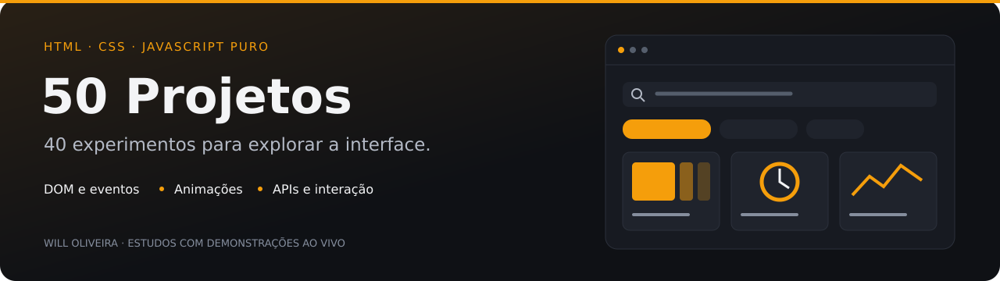

<p align="center">
  
</p>

# 50 Projects · exercícios de interface

Coleção de **39 exercícios presentes no repositório**, com HTML, CSS e JavaScript. O nome identifica a série de estudo; não significa que os 50 exercícios estejam concluídos.

Praticar DOM, eventos, animações e pequenos componentes em exemplos independentes. A coleção documenta minha formação; projetos atuais de engenharia estão no [Will Labs](https://github.com/Will-Ifes/will-labs).

## Explore o diferencial

| Ponto de entrada | O que observar |
| --- | --- |
| [Interação direta](project22/script.js) | Arrastar elementos e desenhar são exemplos de eventos e manipulação do DOM. |
| [Dados de uma API](project37/script.js) | A Pokédex mostra como uma resposta HTTP se transforma em cartões. |

<details>
<summary><strong>Explorar os 39 exercícios</strong></summary>

| Exercício | Tema |
| --- | --- |
| [project1](project1) | xpading Cards |
| [project2](project2) | Progress Steps |
| [project3](project3) | Rotating Navigation |
| [project4](project4) | Hidden Search |
| [project5](project5) | Blurry Loading |
| [project6](project6) | Scroll Animation |
| [project7](project7) | Split Lading Page |
| [project8](project8) | Form Input Wave |
| [project9](project9) | Sound Board |
| [project10](project10) | Dad Jokes |
| [project11](project11) | Event KeyCodes |
| [project12](project12) | FAQ |
| [project13](project13) | Random Choice Picker |
| [project14](project14) | Animated Navigation |
| [project15](project15) | Increment Counter |
| [project16](project16) | Drink Water |
| [project17](project17) | Movie App |
| [project18](project18) | Background Slider |
| [project19](project19) | Theme Clock |
| [project20](project20) | Button Ripple Effect |
| [project21](project21) | Drag d Drop |
| [project22](project22) | Drawing App |
| [project23](project23) | Kinetic Loader |
| [project24](project24) | Content Placeholder |
| [project25](project25) | Sticky Navigation |
| [project26](project26) | Vertical Slider |
| [project27](project27) | Toast Notification |
| [project28](project28) | Github Profiles |
| [project29](project29) | Double Click Heart |
| [project30](project30) | Auto Text Efect |
| [project31](project31) | Password Generator |
| [project32](project32) | Good, Cheap, Fast |
| [project33](project33) | Notes App |
| [project34](project34) | Animated Countdown |
| [project35](project35) | Image Carousel |
| [project36](project36) | Hoverboard |
| [project37](project37) | Pokedex |
| [project38](project38) | Mobile Tab Navigation |
| [project39](project39) | Password Strength Background |

</details>

<details>
<summary><strong>Executar e consultar</strong></summary>

### Executar

```bash
git clone https://github.com/Will-Ifes/50projects.git
cd 50projects
python3 -m http.server 8080
```

Com Python 3 instalado, abra http://localhost:8080/project1/ e troque o número para acessar outro exercício. Cada pasta tem página e estilos próprios; exemplos interativos também possuem um script.

</details>

<details>
<summary>Escopo e referências</summary>

Estudos baseados na série **50 Projects in 50 Days**, de Brad Traversy e Florin Pop. Alguns exemplos dependem de APIs, imagens, áudio ou bibliotecas externas. Não há suíte compartilhada de testes ou contrato de aplicação em produção. Conteúdo de demonstração, incluindo depoimentos, é fictício.

</details>

---

Mantido por **Will Oliveira** · [Perfil](https://github.com/Will-Ifes) · [LinkedIn](https://www.linkedin.com/in/wildemberg-de-jesus-oliveira/)
