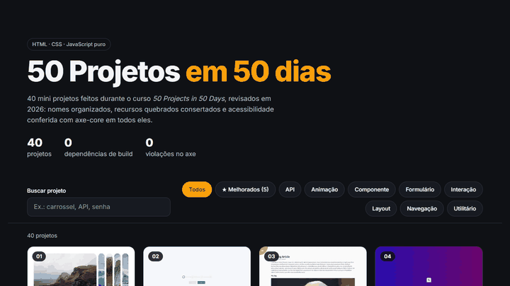

# 50 Projetos · vitrine de HTML, CSS e JavaScript

40 mini projetos feitos durante o curso *50 Projects in 50 Days* (Brad Traversy e Florin Pop), reunidos numa vitrine com busca e filtros, revisados para acessibilidade e com melhorias próprias em alguns deles.

**HTML · CSS · JavaScript puro** · [Abrir a vitrine](https://will-ifes.github.io/50projects/)

<p align="center">
  
</p>

## O que mudou na revisão

| Antes | Depois |
| --- | --- |
| 39 pastas `project1` a `project39`, sem índice | Pastas `NN-nome-do-projeto` e uma vitrine com miniatura, busca sem acento e filtro por categoria |
| Pokédex e Testimonial também em repositórios separados | Tudo neste repositório; os separados podem ser arquivados |
| Recursos quebrados em 5 projetos | Imagens de sites que saíram do ar, caminho absoluto dos sons, URL de fonte malformada, serviço `source.unsplash.com` desativado e `script.js` inexistente: todos corrigidos |
| Violações de acessibilidade em quase todos | **0 violações no axe-core nos 40 projetos**: `<main>`, `h1`, rótulos, nomes de botões, contraste e ordem de títulos |
| Sem caminho de volta | Link "← Vitrine" fixo em cada projeto, foco visível e `prefers-reduced-motion` em todos |

A estrutura comum é aplicada por script, sem mudar o layout de cada projeto: o `<main>` usa `display: contents`, porque muitos projetos centralizam os filhos do `body` com flexbox.

## Melhorias além do curso ★

| Projeto | O que ganhou |
| --- | --- |
| **Pokédex** | Gerações I a IX, busca por nome ou número, filtro por tipo com as cores oficiais, ordenação por força, favoritos salvos no navegador e ficha em `<dialog>` com arte oficial, atributos, habilidades, evoluções clicáveis, grito do Pokémon e navegação anterior/próximo. Antes buscava 898 Pokémon um por um e levava minutos. |
| **Password Generator** | Senhas com `crypto.getRandomValues` (antes `Math.random`) e sem a sequência fixa minúscula → maiúscula → número → símbolo, que tornava a senha previsível; medidor de força por entropia; cópia com aviso acessível em vez de `alert`. |
| **GitHub Profiles** | Nome e bio escapados antes de entrar no HTML (antes permitiam injetar HTML pela bio), repositórios ordenados por estrelas com linguagem, erros de usuário inexistente, limite da API e sem rede, e `fetch` no lugar do axios. |
| **Movie App** | Filmes e sinopses em português, busca codificada corretamente, conteúdo escapado, pôster ausente, estados de vazio e erro e sinopse visível também pelo teclado. |
| **Drawing App** | Pointer events (mouse, toque e caneta), botão para salvar em PNG, traço arredondado e canvas que cabe no celular. |

## Projetos

| # | Projeto | Categoria | O que faz |
| --- | --- | --- | --- |
| 01 | [Expanding Cards](https://will-ifes.github.io/50projects/projetos/01-expanding-cards/) · [código](projetos/01-expanding-cards) | Animação | Painéis de imagem que se expandem ao clicar. |
| 02 | [Progress Steps](https://will-ifes.github.io/50projects/projetos/02-progress-steps/) · [código](projetos/02-progress-steps) | Componente | Indicador de etapas com botões de avançar e voltar. |
| 03 | [Rotating Navigation](https://will-ifes.github.io/50projects/projetos/03-rotating-navigation/) · [código](projetos/03-rotating-navigation) | Navegação | Página que gira para revelar o menu. |
| 04 | [Hidden Search](https://will-ifes.github.io/50projects/projetos/04-hidden-search/) · [código](projetos/04-hidden-search) | Formulário | Campo de busca que se abre a partir de um ícone. |
| 05 | [Blurry Loading](https://will-ifes.github.io/50projects/projetos/05-blurry-loading/) · [código](projetos/05-blurry-loading) | Animação | Imagem que sai do desfoque enquanto um contador carrega. |
| 06 | [Scroll Animation](https://will-ifes.github.io/50projects/projetos/06-scroll-animation/) · [código](projetos/06-scroll-animation) | Animação | Caixas que entram na tela conforme a rolagem. |
| 07 | [Split Landing Page](https://will-ifes.github.io/50projects/projetos/07-split-landing-page/) · [código](projetos/07-split-landing-page) | Layout | Landing page dividida que cresce para o lado do mouse. |
| 08 | [Form Input Wave](https://will-ifes.github.io/50projects/projetos/08-form-input-wave/) · [código](projetos/08-form-input-wave) | Formulário | Formulário de login com rótulos animados letra a letra. |
| 09 | [Sound Board](https://will-ifes.github.io/50projects/projetos/09-sound-board/) · [código](projetos/09-sound-board) | Interação | Botões que tocam efeitos sonoros. |
| 10 | [Dad Jokes](https://will-ifes.github.io/50projects/projetos/10-dad-jokes/) · [código](projetos/10-dad-jokes) | API | Gerador de piadas consumindo a API icanhazdadjoke. |
| 11 | [Event KeyCodes](https://will-ifes.github.io/50projects/projetos/11-event-keycodes/) · [código](projetos/11-event-keycodes) | Interação | Mostra key, keyCode e code de cada tecla pressionada. |
| 12 | [FAQ Collapse](https://will-ifes.github.io/50projects/projetos/12-faq-collapse/) · [código](projetos/12-faq-collapse) | Componente | Perguntas frequentes que abrem e fecham. |
| 13 | [Random Choice Picker](https://will-ifes.github.io/50projects/projetos/13-random-choice-picker/) · [código](projetos/13-random-choice-picker) | Utilitário | Sorteia uma opção entre as digitadas. |
| 14 | [Animated Navigation](https://will-ifes.github.io/50projects/projetos/14-animated-navigation/) · [código](projetos/14-animated-navigation) | Navegação | Barra de navegação que recolhe com animação. |
| 15 | [Incrementing Counter](https://will-ifes.github.io/50projects/projetos/15-incrementing-counter/) · [código](projetos/15-incrementing-counter) | Animação | Contadores de seguidores que sobem até o valor final. |
| 16 | [Drink Water](https://will-ifes.github.io/50projects/projetos/16-drink-water/) · [código](projetos/16-drink-water) | Utilitário | Controle de copos de água bebidos no dia. |
| 17 | [Movie App](https://will-ifes.github.io/50projects/projetos/17-movie-app/) ★ · [código](projetos/17-movie-app) | API | Filmes populares e busca em português pela API do TMDB, com sinopse e nota. |
| 18 | [Background Slider](https://will-ifes.github.io/50projects/projetos/18-background-slider/) · [código](projetos/18-background-slider) | Componente | Carrossel com o fundo acompanhando o slide. |
| 19 | [Theme Clock](https://will-ifes.github.io/50projects/projetos/19-theme-clock/) · [código](projetos/19-theme-clock) | Utilitário | Relógio analógico e digital com tema claro e escuro. |
| 20 | [Button Ripple Effect](https://will-ifes.github.io/50projects/projetos/20-button-ripple-effect/) · [código](projetos/20-button-ripple-effect) | Animação | Botão com onda a partir do ponto clicado. |
| 21 | [Drag N Drop](https://will-ifes.github.io/50projects/projetos/21-drag-n-drop/) · [código](projetos/21-drag-n-drop) | Interação | Imagem arrastável entre caixas. |
| 22 | [Drawing App](https://will-ifes.github.io/50projects/projetos/22-drawing-app/) ★ · [código](projetos/22-drawing-app) | Interação | Desenho em canvas que funciona no toque e salva o resultado em PNG. |
| 23 | [Kinetic Loader](https://will-ifes.github.io/50projects/projetos/23-kinetic-loader/) · [código](projetos/23-kinetic-loader) | Animação | Animação de carregamento feita só com CSS. |
| 24 | [Content Placeholder](https://will-ifes.github.io/50projects/projetos/24-content-placeholder/) · [código](projetos/24-content-placeholder) | Componente | Esqueleto de carregamento antes do conteúdo aparecer. |
| 25 | [Sticky Navbar](https://will-ifes.github.io/50projects/projetos/25-sticky-navbar/) · [código](projetos/25-sticky-navbar) | Navegação | Menu que muda de estilo ao rolar a página. |
| 26 | [Vertical Slider](https://will-ifes.github.io/50projects/projetos/26-vertical-slider/) · [código](projetos/26-vertical-slider) | Componente | Slider em duas colunas que se movem em sentidos opostos. |
| 27 | [Toast Notification](https://will-ifes.github.io/50projects/projetos/27-toast-notification/) · [código](projetos/27-toast-notification) | Componente | Notificações que aparecem e somem sozinhas. |
| 28 | [GitHub Profiles](https://will-ifes.github.io/50projects/projetos/28-github-profiles/) ★ · [código](projetos/28-github-profiles) | API | Perfis do GitHub com os repositórios mais estrelados e tratamento de erros. |
| 29 | [Double Click Heart](https://will-ifes.github.io/50projects/projetos/29-double-click-heart/) · [código](projetos/29-double-click-heart) | Interação | Curtida com coração ao clicar duas vezes na imagem. |
| 30 | [Auto Text Effect](https://will-ifes.github.io/50projects/projetos/30-auto-text-effect/) · [código](projetos/30-auto-text-effect) | Animação | Texto digitado automaticamente com velocidade ajustável. |
| 31 | [Password Generator](https://will-ifes.github.io/50projects/projetos/31-password-generator/) ★ · [código](projetos/31-password-generator) | Utilitário | Senhas com gerador criptográfico e medidor de força. |
| 32 | [Good, Cheap, Fast](https://will-ifes.github.io/50projects/projetos/32-good-cheap-fast/) · [código](projetos/32-good-cheap-fast) | Interação | Três interruptores em que só dois ficam ligados. |
| 33 | [Notes App](https://will-ifes.github.io/50projects/projetos/33-notes-app/) · [código](projetos/33-notes-app) | Utilitário | Notas em Markdown salvas no navegador. |
| 34 | [Animated Countdown](https://will-ifes.github.io/50projects/projetos/34-animated-countdown/) · [código](projetos/34-animated-countdown) | Animação | Contagem regressiva com números girando. |
| 35 | [Image Carousel](https://will-ifes.github.io/50projects/projetos/35-image-carousel/) · [código](projetos/35-image-carousel) | Componente | Carrossel de imagens automático com setas. |
| 36 | [Hoverboard](https://will-ifes.github.io/50projects/projetos/36-hoverboard/) · [código](projetos/36-hoverboard) | Interação | Grade de quadrados que acendem ao passar o mouse. |
| 37 | [Pokedex](https://will-ifes.github.io/50projects/projetos/37-pokedex/) ★ · [código](projetos/37-pokedex) | API | Pokédex com gerações, filtro por tipo, favoritos e ficha completa de cada Pokémon. |
| 38 | [Mobile Tab Navigation](https://will-ifes.github.io/50projects/projetos/38-mobile-tab-navigation/) · [código](projetos/38-mobile-tab-navigation) | Navegação | Navegação por abas imitando um aplicativo de celular. |
| 39 | [Password Strength Background](https://will-ifes.github.io/50projects/projetos/39-password-strength-background/) · [código](projetos/39-password-strength-background) | Formulário | Fundo que fica nítido conforme a senha fica forte. |
| 40 | [Testimonial Box Switcher](https://will-ifes.github.io/50projects/projetos/40-testimonial-box-switcher/) · [código](projetos/40-testimonial-box-switcher) | Componente | Depoimentos que se alternam com barra de progresso. |

## Como manter

Tudo é gerado a partir de [`projetos.json`](projetos.json):

```bash
python scripts/estruturar.py      # aplica <main>, h1, título e link de volta em projetos novos
python scripts/corrigir_a11y.py   # correções pontuais de acessibilidade (idempotente)
python scripts/gerar_vitrine.py   # regenera o index.html da vitrine
python scripts/gerar_readme.py    # regenera este README
```

Para rodar localmente basta um servidor estático na raiz:

```bash
python -m http.server 8080
```

## Observações

- O **Movie App** usa uma chave pública da API do TMDB que veio do curso e já estava no repositório. Num site estático não há como escondê-la; para uso próprio, gere a sua em [themoviedb.org](https://www.themoviedb.org/settings/api).
- As interfaces dos projetos continuam em inglês, como no curso. A vitrine, os textos novos e o Movie App estão em português.

---

Mantido por **Will Oliveira** · [Perfil](https://github.com/Will-Ifes) · [LinkedIn](https://www.linkedin.com/in/wildemberg-de-jesus-oliveira/)
